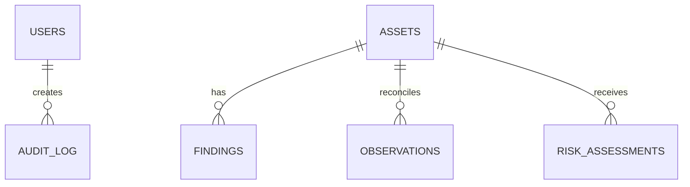

# Deepsight data model

The initial migration creates `users`, `assets`, and `findings`. The production model expands these into immutable observations, time-ranged identifiers, identity decisions, services, relationships, intelligence, ML outputs, risk history, investigations, job runs, and reports.

The observation slice currently includes `sources` and append-only `observations`.
Observations preserve source/category metadata, normalized identifiers and attributes,
timestamps, processing status, epistemic class, quality flags/score, and a unique
content hash for deduplication. Updates and deletes are rejected at the ORM boundary.

