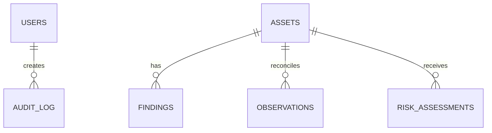

# Deepsight data model

The initial migration creates `users`, `assets`, and `findings`. The production model expands these into immutable observations, time-ranged identifiers, identity decisions, services, relationships, intelligence, ML outputs, risk history, investigations, job runs, and reports.

