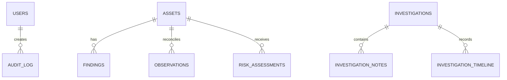

# Deepsight data model

The initial migration creates `users`, `assets`, and `findings`. The production model expands these into immutable observations, time-ranged identifiers, identity decisions, services, relationships, intelligence, ML outputs, risk history, investigations, job runs, and reports.

The observation slice currently includes `sources` and append-only `observations`.
Observations preserve source/category metadata, normalized identifiers and attributes,
timestamps, processing status, epistemic class, quality flags/score, and a unique
content hash for deduplication. Updates and deletes are rejected at the ORM boundary.

The investigations/report persistence slice adds `investigations` with an owner,
workflow status, and conclusions; append-only analyst-oriented
`investigation_notes` and `investigation_timeline` records; and report metadata
in `reports`. Report metadata keeps the report type, scope, evidence sources,
limitations, and object-storage reference separate from generated report content.
The async service helpers flush records so callers can compose them into a
transaction and commit at the API or worker boundary.

The relationship/integration slice adds `relationships`, which connects two
assets with a typed, confidence-scored edge and JSON evidence/metadata, and
`integrations`, which stores connector provider state and JSON configuration.
Integration credentials are intentionally not modeled as plaintext: only a
masked display value and an encrypted/secret-store reference placeholder may
be persisted. Both slices expose async service helpers that flush without
committing, so callers retain transaction ownership.
